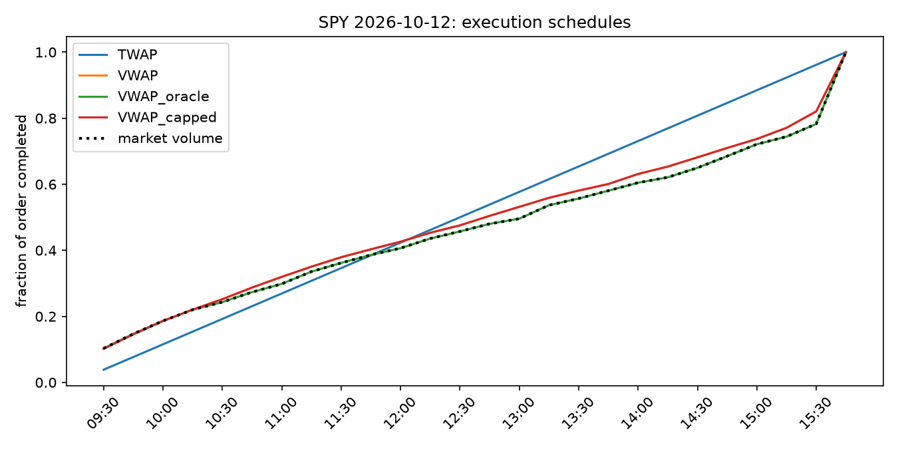
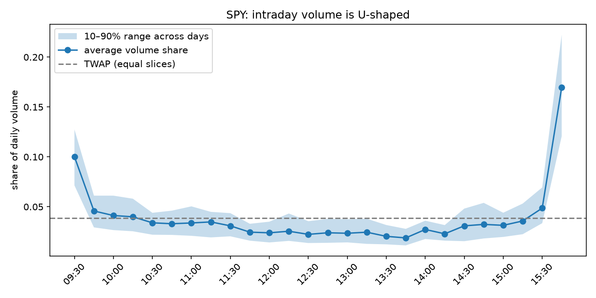
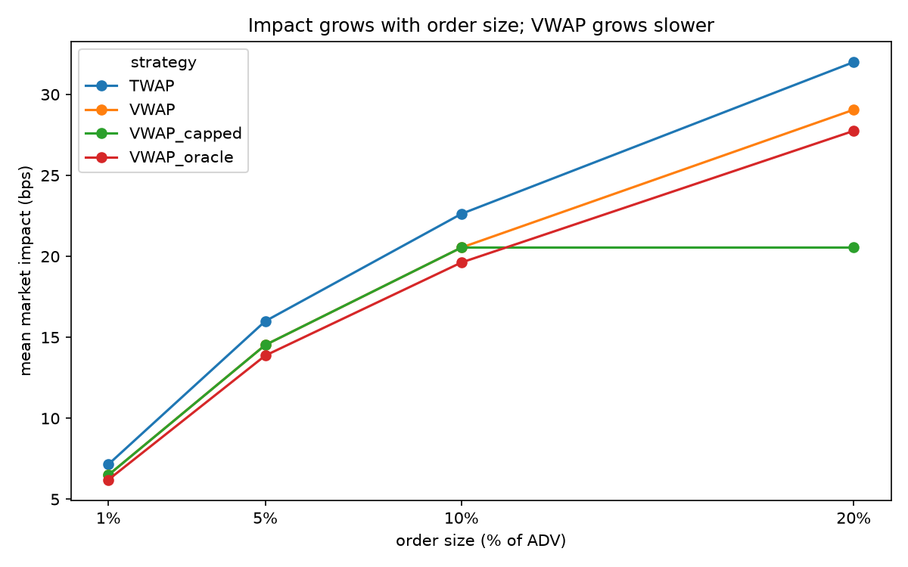
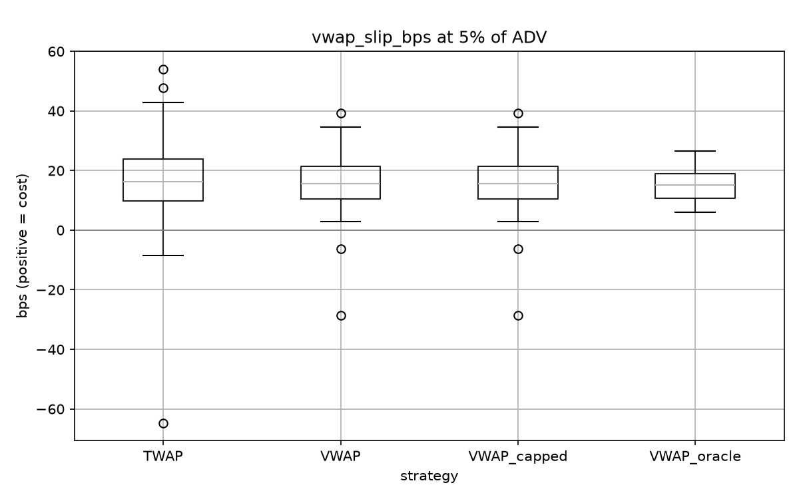

# TWAP vs VWAP: Measuring the Cost of Execution Strategy

A backtest of two classic execution algorithms on real intraday data for five liquid US stocks. A large order is split into child orders over the trading day, either evenly in time (**TWAP**) or in proportion to forecast market volume (**VWAP**). Each simulated fill pays a half spread plus square-root market impact. Results are tested for statistical significance with a paired bootstrap, checked against an analytical derivation, and stress-tested under different modelling assumptions.



## Key results

Based on 145 ticker-days (SPY, AAPL, MSFT, JPM, XOM; Aug–Oct 2026), 4 order sizes and 4 strategies, for 2,320 simulated executions:

- **VWAP has 9.2% lower market impact than TWAP at every order size.** The absolute saving grows with the square root of order size: 0.66, 1.47, 2.08 and 2.94 bps at 1%, 5%, 10% and 20% of average daily volume (ADV). Every 95% confidence interval lies entirely below zero.
- **VWAP cuts tracking error to the VWAP benchmark by 25–39%.** The standard deviation of VWAP slippage falls from 11.4 to 7.0 bps at 1% ADV, and from 16.2 to 12.2 bps at 20% ADV.
- **The result follows from theory.** Under the cost model, constant participation provably minimises expected impact, and the backtest matches the closed-form cost ratios to machine precision. TWAP pays 15% more impact than the best possible schedule; real VWAP pays 5% more because its volume forecast is imperfect. VWAP recovers 69% of the gap.
- **The difference is detectable despite heavy market noise.** Implementation shortfall varies by about 80–88 bps (one standard deviation) from day to day, yet the paired bootstrap finds VWAP significantly cheaper from 5% ADV upwards. At 1% ADV the difference is not significant: for small orders the day's price move matters far more than the algorithm.
- **The conclusions are robust.** VWAP wins for impact coefficients from 0.25 to 1.0 and for forecast lookbacks from 5 to 20 days. The assumptions change the size of the advantage, never the winner.
- **Participation caps trade cost for completion.** With a 10% cap, orders up to 10% of ADV are unaffected; a 20% order fills only 50%.

---

## 1. Background

**Parent and child orders.** A fund that needs to buy a large number of shares (the *parent order*) does not send it all at once. Its own demand would push the price up. An execution algorithm splits it into many small *child orders* spread over the day.

**Market impact.** Each child order moves the price against the trader by an amount that depends on how large it is relative to the market's volume at that moment, its *participation rate*. Empirically, impact grows roughly with the square root of participation: doubling the order raises impact by about 41%, not 100%.

**The intraday volume curve.** US stocks trade heavily at the open, thinly around midday and heavily again into the close, where the closing auction alone can account for 15–20% of the day's volume. The same number of shares is a much larger fraction of the market at 13:00 than at 09:35 or 15:45.

**The two strategies.**

| Strategy | Shares in each 15-minute bucket | Idea |
|---|---|---|
| TWAP (time-weighted average price) | equal: order ÷ 26 | simple and predictable; ignores volume |
| VWAP (volume-weighted average price) | order × forecast share of the day's volume in that bucket | trade more when the market is busy, keeping participation even |

**Benchmarks.** All costs are in basis points (1 bp = 0.01%); positive means a cost.

| Metric | Definition | Answers |
|---|---|---|
| Implementation shortfall (IS) | average fill price vs the 09:30 arrival price | What did execution cost relative to the decision price? Includes the market's move during the day. |
| VWAP slippage | average fill price vs the day's market VWAP | Did the order get the market's average price? This is the standard benchmark for VWAP algorithms. |
| Impact | quantity-weighted modelled impact | The part of the cost the schedule controls. No market noise. |

## 2. Data

| | |
|---|---|
| Source | Yahoo Finance via `yfinance`, 5-minute bars |
| Tickers | SPY, AAPL, MSFT, JPM, XOM (an index ETF plus four sectors) |
| Period | 17 Aug – 12 Oct 2026, 39 trading days per ticker |
| Session | Regular hours only, 09:30–16:00 New York time; half-days and incomplete days removed |
| Buckets | 26 × 15-minute buckets per day; bucket VWAP estimated from the volume-weighted typical price `(high + low + close) / 3` of its three 5-minute bars |
| Test sample | First 10 days per ticker used only as history; 29 test days per ticker, 145 ticker-days in total |

Yahoo keeps only about 60 days of intraday history, so the raw data is cached to `data/` and committed for reproducibility.

## 3. Method

```
data_loader ─► volume_profile ─► strategies ─► simulator ─► metrics ─► backtest ─► main / plots
download,      forecast curve,    TWAP, VWAP,    fill price    IS, VWAP     every       summary, bootstrap,
clean, bucket  ADV, volatility    oracle, capped per bucket    slippage     ticker×day  figures
                                                                            ×size×strategy
```

**Strategies.**

| Strategy | Schedule | Information used |
|---|---|---|
| TWAP | order ÷ 26 per bucket | none |
| VWAP | order × forecast volume share | average volume curve of the previous 10 days |
| VWAP_oracle | order × *realized* volume share | today's actual volume (a benchmark only, impossible live) |
| VWAP_capped | VWAP, limited to 10% of forecast bucket volume; leftovers carried forward, unfilled at the close | forecast and ADV |

Order sizes are 1%, 5%, 10% and 20% of ADV, all buys. Each size is simulated independently against the same replayed day.

**Cost model.** For bucket *i*, with your shares $q_i$, market volume $V_i$ and bucket VWAP $p_i$:

```math
\pi_i = \frac{q_i}{V_i}, \qquad
\text{impact}_i = Y\,\sigma\,\sqrt{\pi_i}, \qquad
\text{cost}_i = s + \text{impact}_i, \qquad
P_i = p_i\,(1 + \text{cost}_i)
```

| Symbol | Meaning | Value |
|---|---|---|
| $\pi_i$ | participation: your share of the bucket's trading | from the schedule |
| $\sigma$ | daily volatility, standard deviation of the previous 10 close-to-close returns | 46–195 bps (median 62 for SPY, 99–157 for the single stocks) |
| $Y$ | impact coefficient | 0.5 |
| $s$ | half spread | 1 bp |
| $P_i$ | simulated fill price | |

**No look-ahead.** The volume forecast, ADV and volatility use only days strictly before the trade date. A unit test overwrites the trade date's data with nonsense and checks that the forecast does not change. Only the oracle benchmark sees the realized curve.

**Statistical testing.** Every strategy trades the same ticker on the same day, so the market's move is shared. The test uses the per-day difference VWAP − TWAP, which cancels that move, and resamples those differences 10,000 times (paired bootstrap) for a 95% confidence interval. The bootstrap makes no assumption that costs are normally distributed, which matters because trading costs are fat-tailed.

## 4. Why VWAP should win: theory

Assume prices have no predictable drift, so the expected price path is the same for every schedule. The expected cost of an order of $Q$ shares then depends on the schedule only through

```math
J(q) = \sum_{i=1}^{N} \frac{q_i^{3/2}}{\sqrt{V_i}}
\qquad \text{subject to} \qquad \sum_{i} q_i = Q .
```

The half spread is paid on every share whatever the schedule, so it drops out. Setting the derivative of the Lagrangian to zero gives

```math
\frac{3}{2}\sqrt{\frac{q_i}{V_i}} = \lambda
\;\;\Longrightarrow\;\;
\frac{q_i}{V_i} = \text{constant}
\;\;\Longrightarrow\;\;
q_i^{*} = Q\,\frac{V_i}{V}.
```

**Equal participation in every bucket is optimal, which is exactly VWAP.** Because $x^{3/2}$ is strictly convex, this is the unique minimum. The minimum cost works out to the square-root law for the whole order, $Y\sigma\sqrt{Q/V}$ per share.

How much the alternatives lose, with $u_i = N v_i$ the bucket's volume relative to a flat day and $f_i = v_i(1+\varepsilon_i)$ the forecast:

```math
R_{\text{TWAP}} = \frac{J_{\text{TWAP}}}{J^{*}} = \frac{1}{N}\sum_i u_i^{-1/2} \;\ge\; 1,
\qquad
R_{\text{VWAP}} = \frac{J_{\text{VWAP}}}{J^{*}} \;\approx\; 1 + \frac{3}{8}\sum_i v_i\,\varepsilon_i^{2}.
```

- TWAP's penalty is at least 1 by Jensen's inequality, with equality only for a flat volume curve. The more U-shaped the day, the larger the penalty.
- Forecast error costs only quadratically, so small errors are cheap.
- VWAP stays optimal for any impact law $\pi^{\delta}$ with $\delta > 0$. The exponent changes the size of TWAP's penalty, not the optimal shape.
- These ratios do not depend on order size, which is why VWAP's relative saving is the same 9.2% at every size.

## 5. Results

### 5.1 Volume is U-shaped



For SPY, about 10% of the day's volume trades in the first 15 minutes and about 17% in the last 15 (the closing auction), against about 2% around 13:45. TWAP's flat 3.8% per bucket therefore puts nearly twice the market's share into the quietest part of the day. The shaded band shows that the curve varies from day to day, which limits how well any forecast can do.

### 5.2 Impact: VWAP is cheaper, and the gap grows with size



| Order size | TWAP impact | VWAP impact | VWAP_oracle impact | VWAP − TWAP [95% CI] |
|---|---|---|---|---|
| 1% ADV | 7.15 | 6.50 | 6.20 | −0.66 [−0.73, −0.59] |
| 5% ADV | 16.00 | 14.53 | 13.87 | −1.47 [−1.63, −1.33] |
| 10% ADV | 22.62 | 20.54 | 19.62 | −2.08 [−2.31, −1.88] |
| 20% ADV | 32.00 | 29.05 | 27.75 | −2.94 [−3.26, −2.65] |

All in bps. Impact curves bend over because of the square root. The VWAP − TWAP gap scales almost exactly with √(order size): 0.66 × √5 = 1.48, 0.66 × √20 = 2.95. Average peak participation at 20% ADV is 57% of a bucket's volume for TWAP and 41% for VWAP.

### 5.3 Tracking risk: VWAP is more predictable



| Order size | Std of VWAP slippage: TWAP | VWAP | VWAP_oracle | Reduction, VWAP vs TWAP |
|---|---|---|---|---|
| 1% ADV | 11.42 | 6.98 | 2.33 | 39% |
| 5% ADV | 12.54 | 8.25 | 5.21 | 34% |
| 10% ADV | 13.86 | 9.71 | 7.37 | 30% |
| 20% ADV | 16.21 | 12.18 | 10.42 | 25% |

Median costs are similar across strategies; the difference is in the spread of outcomes. For a client benchmarked against the day's VWAP, VWAP execution delivers a much more predictable result, which is often the main reason it is chosen.

### 5.4 Statistical significance

VWAP − TWAP, paired bootstrap, 95% CI (bps; negative = VWAP cheaper):

| Order size | Impact | VWAP slippage | Implementation shortfall |
|---|---|---|---|
| 1% ADV | −0.66 [−0.73, −0.59] | −0.77 [−2.36, +0.84] | −0.82 [−2.42, +0.78] |
| 5% ADV | −1.47 [−1.63, −1.33] | −1.58 [−3.18, +0.04] | −1.64 [−3.23, −0.02] |
| 10% ADV | −2.08 [−2.31, −1.88] | −2.19 [−3.79, −0.56] | −2.25 [−3.86, −0.62] |
| 20% ADV | −2.94 [−3.26, −2.65] | −3.05 [−4.67, −1.41] | −3.11 [−4.73, −1.46] |

Impact contains no market noise, so its intervals are tight at every size. Slippage and IS include the day's price path, which varies by 80–88 bps (one standard deviation). Pairing removes most of that, and the difference becomes significant from about 5–10% ADV. For small orders, the strategy choice is swamped by what the market does that day.

### 5.5 Forecast error and the theory check

The 10-day average forecast puts 13–16% of the order in the "wrong" bucket compared with perfect foresight (SPY 0.159, AAPL 0.139, MSFT 0.136, JPM 0.131, XOM 0.131).

| Strategy | Mean impact at 5% ADV (bps) | Relative to best possible |
|---|---|---|
| VWAP_oracle | 13.87 | 1.000 |
| VWAP | 14.53 | 1.047 |
| TWAP | 16.00 | 1.153 |

On every one of the 145 ticker-days, TWAP impact ÷ oracle impact equals $R_{\text{TWAP}}$ and VWAP impact ÷ oracle impact equals $R_{\text{VWAP}}$, to within $10^{-15}$. This confirms that the simulator implements the model correctly. Of TWAP's 2.12 bps excess over the best schedule, VWAP recovers 1.47 bps (69%). The remaining 0.65 bps is the cost of not knowing the day's volume curve in advance.

### 5.6 Participation cap

| Order size | Fill rate | Mean peak realized participation | Impact on filled shares (bps) | Uncapped VWAP impact (bps) |
|---|---|---|---|---|
| 1% ADV | 1.00 | 2.1% | 6.50 | 6.50 |
| 5% ADV | 1.00 | 10.4% | 14.53 | 14.53 |
| 10% ADV | 1.00 | 20.7% | 20.54 | 20.54 |
| 20% ADV | **0.50** | 20.7% | 20.54 | 29.05 |

Up to 10% ADV the cap never binds. At 20% ADV only half the order is filled. Its impact looks lower only because it is averaged over the shares actually traded, which makes it effectively a 10% ADV order. The unfilled half would have to be bought later at an unknown price, an opportunity cost this model does not charge. Peak realized participation exceeds the 10% cap because the cap is applied to *forecast* bucket volume; a live algorithm would cap against real-time volume.

### 5.7 Sensitivity checks

`sensitivity.py` re-runs the full backtest with one assumption changed at a time.

**Impact coefficient Y** (base case 0.5):

| Y | Order size | TWAP impact | VWAP impact | VWAP − TWAP impact | VWAP − TWAP IS |
|---|---|---|---|---|---|
| 0.25 | 5% ADV | 8.00 | 7.26 | −0.74 [−0.82, −0.66] | −0.90 [−2.50, +0.70] |
| 0.25 | 20% ADV | 16.00 | 14.53 | −1.47 [−1.63, −1.33] | −1.64 [−3.23, −0.02] |
| **0.50** | 5% ADV | 16.00 | 14.53 | −1.47 [−1.63, −1.33] | −1.64 [−3.23, −0.02] |
| **0.50** | 20% ADV | 32.00 | 29.05 | −2.94 [−3.26, −2.65] | −3.11 [−4.73, −1.46] |
| 1.00 | 5% ADV | 32.00 | 29.05 | −2.94 [−3.26, −2.65] | −3.11 [−4.73, −1.46] |
| 1.00 | 20% ADV | 63.99 | 58.11 | −5.89 [−6.53, −5.31] | −6.05 [−7.77, −4.31] |

Every impact figure and every gap scales exactly with Y, and VWAP wins in every case. Y = 0.25 at 20% ADV reproduces Y = 0.5 at 5% ADV exactly, because impact depends only on $Y\sqrt{\text{size}}$ (0.25 × √0.20 = 0.5 × √0.05). With the weakest impact (Y = 0.25), the IS difference at 5% ADV is no longer significant.

**Lookback window** (base case 10 days), 5% ADV:

| Lookback | Test ticker-days | Forecast error | VWAP − TWAP impact | VWAP − TWAP IS |
|---|---|---|---|---|
| 5 | 170 | 0.147 | −1.33 [−1.49, −1.18] | −2.12 [−3.70, −0.57] |
| **10** | 145 | 0.139 | −1.47 [−1.63, −1.33] | −1.64 [−3.23, −0.02] |
| 20 | 95 | 0.137 | −1.56 [−1.75, −1.39] | −2.12 [−3.89, −0.33] |

VWAP beats TWAP for every lookback. Forecast error barely improves beyond 10 days: averaging more days removes sampling noise, but most of the remaining error is genuine day-to-day variation in the volume curve. Each lookback leaves a different number of test days, and choosing the best one on this same data would be in-sample tuning, so 10 days is kept as a reasonable default rather than an optimum.

## 6. Limitations

- **No feedback.** Simulated trades are added on top of historical prices; they neither appear in the bucket's VWAP nor move later prices. Real impact partly persists and decays over time.
- **Fill model.** Each child order fills completely at the bucket VWAP plus modelled cost. There is no order book, queue position or partial fill, and bucket VWAP is estimated from 5-minute bars rather than individual trades.
- **Uncalibrated costs.** The half spread and impact coefficient are assumptions in the range reported in the literature, not fitted to real fills. The sensitivity check shows this changes the size of the VWAP advantage but not its direction.
- **Constant volatility and spread within the day.** Both are higher at the open in real markets.
- **Short sample.** 39 trading days per ticker in a single market regime; volatility estimates from 10 returns are noisy (roughly ±25%).
- **Market drift in IS.** In this sample the day's VWAP was on average about 2 bps above the 09:30 open, which adds about 2 bps to every strategy's IS. It affects all strategies equally and cancels in the paired comparison.
- **Risk-neutral objective.** Strategies are compared on expected cost. A risk-averse trader might prefer to trade faster early to reduce exposure to the price path.
- **No opportunity cost** is charged for shares the capped strategy leaves unfilled.

## 7. Possible extensions

- Better volume forecasts: exponentially weighted or median curves, day-of-week effects, special handling of index-rebalance and month-end days.
- A risk-averse schedule (Almgren–Chriss) as a third strategy, to show the trade-off between expected cost and timing risk.
- A participation cap measured against real-time rather than forecast volume.
- A transient-impact (propagator) model in which impact carries over and decays between buckets.
- Longer history, smaller and less liquid stocks, and sell orders.

## 8. How to run

```bash
python -m venv .venv && source .venv/bin/activate
pip install -r requirements.txt

pytest                       # 36 unit and sanity tests on synthetic data
python main.py               # backtest, summary tables, bootstrap tests and figures
python main.py --no-plots    # results only
python main.py --plots-only  # redraw figures from results/results.csv
python sensitivity.py        # re-run with different impact coefficients and lookbacks (~20 s)
```

The first run downloads data from Yahoo Finance into `data/`; later runs read the cached CSVs. All parameters (tickers, bucket size, lookback, order sizes, cost model, participation cap) live in `config.py`.

## 9. Project structure

```
config.py              all parameters
main.py                entry point: backtest, report, figures
sensitivity.py         re-runs the backtest under different assumptions
src/
  data_loader.py       download in 7-day chunks, cache, clean to regular hours, bucket
  volume_profile.py    volume curves, forecast, ADV, volatility (past data only)
  strategies.py        TWAP, VWAP, participation cap
  simulator.py         fill prices with half spread and square-root impact
  metrics.py           benchmarks, slippage, summary, paired bootstrap
  backtest.py          the experiment loop: one row per ticker × day × size × strategy
  plots.py             figures
tests/                 unit tests with synthetic data, including a look-ahead test
data/                  cached 5-minute bars
results/               results.csv, sensitivity.csv, figures/
```

## References

- Almgren, R. and Chriss, N. (2000). Optimal execution of portfolio transactions. *Journal of Risk*, 3(2), 5–39.
- Almgren, R., Thum, C., Hauptmann, E. and Li, H. (2005). Direct estimation of equity market impact. *Risk*, 18(7).
- Bouchaud, J.-P., Bonart, J., Donier, J. and Gould, M. (2018). *Trades, Quotes and Prices: Financial Markets Under the Microscope*. Cambridge University Press.
- Obizhaeva, A. and Wang, J. (2013). Optimal trading strategy and supply/demand dynamics. *Journal of Financial Markets*, 16(1), 1–32.
- Tóth, B., Lempérière, Y., Deremble, C., de Lataillade, J., Kockelkoren, J. and Bouchaud, J.-P. (2011). Anomalous price impact and the critical nature of liquidity in financial markets. *Physical Review X*, 1, 021006.
